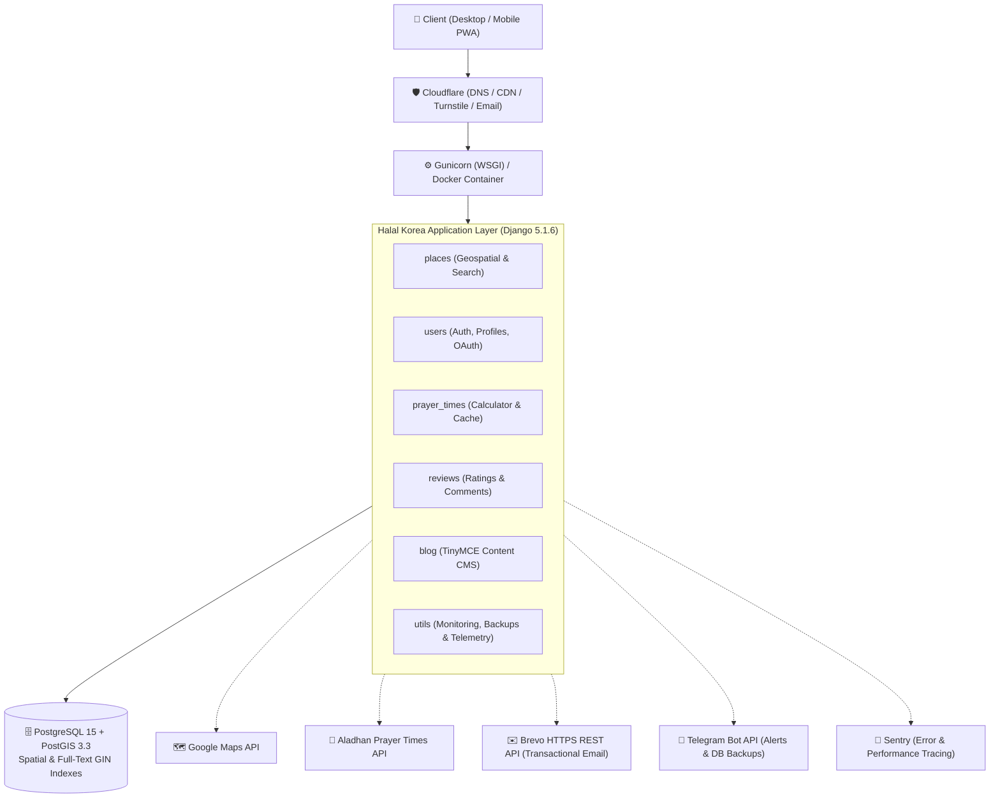

<p align="center">
  <a href="https://github.com/JavohirMX/halal-korea">
    
  </a>
</p>

<h1 align="center">Halal Korea (할랄 코리아) 🇰🇷</h1>

<p align="center">
  <strong>Your trusted open-source guide to halal dining, markets, mosques, and prayer facilities across South Korea.</strong>
</p>

<p align="center">
  <a href="https://djangoproject.com/"></a>
  <a href="https://python.org/"></a>
  <a href="https://postgis.net/"></a>
  <a href="https://tailwindcss.com/"></a>
  <a href="https://docker.com/"></a>
  <a href="LICENSE"></a>
  <a href="https://sentry.io/"></a>
  <a href="#-contributing"></a>
</p>

<p align="center">
  <a href="#-about-halal-korea">About</a> •
  <a href="#-key-features">Key Features</a> •
  <a href="#-system-architecture">Architecture</a> •
  <a href="#-quick-start">Quick Start</a> •
  <a href="#-environment-configuration">Configuration</a> •
  <a href="#-documentation">Documentation</a> •
  <a href="#-contributing">Contributing</a>
</p>

---

## 💡 About Halal Korea

Navigating halal food and Islamic religious facilities in South Korea can be challenging for Muslim residents, international students, and tourists.

**Halal Korea** solves this with a modern, community-verified geospatial platform. Combining **PostGIS spatial indexing**, **Google Maps with Korean navigation deep-links (Naver / Kakao)**, **bilingual Hangul-English transliteration search**, and **accurate Islamic prayer times**, Halal Korea empowers users to explore South Korea with peace of mind.

```
       📍 Verified Places          🔍 Bi-directional Search          🕌 Prayer Times
    Restaurants, Markets, Mosques     Korean (한글) ↔ English         Accurate Times for Any
      & Prayer Rooms in Korea         Full-text search with GIN        Korean City with Cache
```

---

## ✨ Key Features

### 🗺️ Interactive Geospatial Map
- **PostGIS Spatial Queries**: Fast, real-time distance calculations and radius searches around the user or selected city.
- **Interactive Google Maps**: Custom category-specific pins (restaurants, markets, mosques, prayer rooms).
- **Korean Navigation Deep Links**: 1-click directions via **Google Maps**, **Kakao Map (카카오맵)**, and **Naver Map (네이버 지도)** for reliable pedestrian routing in Korea.

### 🔍 Smart Korean ↔ English Transliteration Search
- **Phonetic Matching**: Search in English ("bibimbap", "tteokbokki") or Korean ("비빔밥", "떡볶이") seamlessly.
- **Full-Text GIN Indexing**: Weighted PostgreSQL full-text search across place names, descriptions, and addresses.
- **Synonym Expansion & Autocomplete**: "Masjid" automatically maps to mosques; real-time debounced suggestions with keyboard navigation.

### 🕌 Islamic Prayer Times & Qibla
- **Real-Time Accuracy**: Location-aware prayer times computed using the Aladhan API with a **23-hour database cache**.
- **Juristic & Calculation Standards**: Configurable calculation methods (Muslim World League, ISNA, Umm Al-Qura, Egyptian) and Asr juristic options (Standard / Hanafi).

### 🌐 Tri-Lingual Localization (i18n)
- **Three Languages Supported**: English (`en`), Korean (`ko`), and Uzbek (`uz`).
- **Smart Language Detection**: Automatically respects user profile settings, browser `Accept-Language` headers, or custom URL query parameters.
- **In-App Translation Portal**: Integrated with Django Rosetta for easy translation updates.

### 👥 Community-Driven Verification
- **User Submissions & Edits**: Community members can submit new places or propose field corrections to existing listings.
- **Photo Contributions with Watermarking**: Automatic image watermarking via Pillow to protect community content.
- **5-Star Reviews**: Verified user feedback and ratings.

### 🛡️ Enterprise Security & Telemetry
- **6 Admin Dashboards**: Real-time system monitoring, slow query metrics, security event auditing, and content moderation queue powered by Django Jazzmin dark theme.
- **Automated Telegram Backups**: Smart database backups sent directly to an administrative Telegram channel when changes occur.
- **Privacy-Preserving Logs**: Structured JSON logging with hashed IPs and hashed user-agents.
- **Bot Defense**: Cloudflare Turnstile CAPTCHA and layered rate limiting on forms and authentication.

### ✍️ Integrated Content CMS
- **Full-Featured Blog**: Rich text TinyMCE editor, image uploads, categorized tags, and automatic slug generation.
- **Place Linking**: Direct cross-referencing between blog articles and featured halal establishments.

---

## 🏗️ System Architecture



### Tech Stack Summary

| Layer | Technologies |
|---|---|
| **Backend Framework** | [Django 5.1.6](https://www.djangoproject.com/) (Python 3.12) |
| **Database & GIS** | [PostgreSQL 15](https://www.postgresql.org/) with [PostGIS 3.3](https://postgis.net/) extension |
| **Frontend & UI** | [Tailwind CSS](https://tailwindcss.com/), [Alpine.js](https://alpinejs.dev/), Swiper.js, Vanilla JS |
| **Map Services** | Google Maps JavaScript API, Kakao Map, Naver Map |
| **Authentication** | Django AllAuth (Email + Google & GitHub OAuth2) |
| **Email Infrastructure** | [Brevo REST API](https://www.brevo.com/) (port 443 HTTPS bypasses VPS SMTP blocks) |
| **Monitoring & Logs** | Django Jazzmin, python-json-logger, [Sentry](https://sentry.io/) |
| **Containerization** | Docker, Docker Compose, Gunicorn |

---

## 🚀 Quick Start

Get Halal Korea running locally in under **3 minutes** using Docker.

### Option A: Docker Compose (Recommended)

#### 1. Clone the repository
```bash
git clone git@github.com:JavohirMX/halal-korea.git
cd halal-korea
```

#### 2. Create environment configuration
```bash
cp .env.example .env
```
*(Optionally open `.env` and add your `GOOGLE_MAPS_API_KEY` for map rendering).*

#### 3. Build and launch containers
```bash
docker-compose up -d --build
```

#### 4. Run database migrations & create superuser
```bash
docker-compose exec web python manage.py migrate
docker-compose exec web python manage.py createsuperuser
```

#### 5. Open in browser
Visit **[http://localhost:8000](http://localhost:8000)** and log into admin at **[http://localhost:8000/admin/](http://localhost:8000/admin/)**.

---

### Option B: Local Python Environment

<details>
<summary><strong>Click to view native virtualenv setup steps</strong></summary>

#### Prerequisites
- **Python 3.12+**
- **PostgreSQL 15+** with **PostGIS 3.3+**
- System geospatial libraries: `gdal`, `geos`, `proj`
  - macOS: `brew install gdal geos proj postgresql postgis`
  - Ubuntu/Debian: `sudo apt-get install binutils libproj-dev gdal-bin libgdal-dev postgresql-postgis`

#### 1. Initialize Virtual Environment
```bash
python3 -m venv .venv
source .venv/bin/activate
pip install --upgrade pip
pip install -r requirements.txt
```

#### 2. Configure Database
```bash
createdb halal_korea
psql -d halal_korea -c "CREATE EXTENSION postgis;"
```

#### 3. Setup Environment Variables
```bash
cp .env.example .env
# Edit .env with your local PostgreSQL user & credentials
```

#### 4. Migrate, Collect Static & Run
```bash
python manage.py migrate
python manage.py collectstatic --noinput
python manage.py compilemessages
python manage.py runserver
```

</details>

---

## ⚙️ Environment Configuration

### Essential Settings

| Variable | Description | Default / Example |
|---|---|---|
| `DJANGO_SECRET_KEY` | Unique cryptographic signing key | *Generate a secure 50+ char key* |
| `DJANGO_DEBUG` | Enable debug mode for local development | `True` *(set `False` in prod)* |
| `ALLOWED_HOSTS` | Comma-separated list of valid host headers | `localhost,127.0.0.1` |
| `DB_NAME` | PostgreSQL database name | `halal_korea` |
| `DB_USER` | PostgreSQL user | `postgres` |
| `DB_PASSWORD` | PostgreSQL password | *Your DB password* |
| `DB_HOST` | PostgreSQL host | `localhost` (or `db` for Docker) |
| `DB_PORT` | PostgreSQL port | `5432` |
| `GOOGLE_MAPS_API_KEY` | Google Maps JavaScript API key | `AIza...` |

<details>
<summary><strong>Click to view optional external service configurations</strong></summary>

### External Services & Integrations

```env
# Email (Brevo REST API - recommended for VPS)
EMAIL_BACKEND=utils.email_backends.brevo_api.BrevoAPIBackend
BREVO_API_KEY=xkeysib-your-key-here
DEFAULT_FROM_EMAIL=Halal Korea <noreply@halal-korea.com>

# Telegram Notifications & Automated DB Backups
TELEGRAM_BOT_TOKEN=123456:ABC-DEF1234ghIkl-zyx57W2v1u123ew11
TELEGRAM_CHAT_ID=-1001234567890
TELEGRAM_NOTIFICATIONS_ENABLED=True

# Social Authentication (Google & GitHub)
GOOGLE_OAUTH_CLIENT_ID=your-google-client-id
GOOGLE_OAUTH_CLIENT_SECRET=your-google-client-secret
GITHUB_CLIENT_ID=your-github-client-id
GITHUB_CLIENT_SECRET=your-github-client-secret

# Cloudflare Turnstile CAPTCHA
TURNSTILE_SITE_KEY=0x4AAAAAA...
TURNSTILE_SECRET_KEY=0x4AAAAAA...

# Error & Performance Monitoring (Sentry)
SENTRY_DSN=https://examplePublicKey@o0.ingest.sentry.io/0
SENTRY_ENVIRONMENT=development
```

</details>

---

## 📱 Project Layout

```
halal-korea/
├── config/             # Django settings, root URLs, sitemaps, middleware
├── places/             # Halal places models, PostGIS queries, suggestion workflows
├── users/              # Custom User model, AllAuth OAuth, profiles, verification
├── prayer_times/       # Aladhan calculation engine & 23-hour cache models
├── reviews/            # 1-5 star community reviews with rating constraints
├── blog/               # TinyMCE rich text blog CMS & related place linkages
├── contact/            # AJAX contact form with rate limiting & Telegram alerts
├── feedback/           # Floating feedback widget with user engagement telemetry
├── utils/              # Monitoring dashboards, DB backups, watermarking, middleware
├── static/             # Tailwind stylesheets, logos, map markers, custom JS
├── locale/             # Translation catalogs (ko, uz)
├── docs/               # 29+ technical architecture & operations guides
├── Dockerfile          # Python 3.12-slim container with GDAL/PostGIS dependencies
└── docker-compose.yaml # Multi-container orchestration (web, db, telegram-bot-api)
```

---

## 📚 Documentation

Deep-dive architectural, operational, and development guides are maintained in [`docs/`](docs/):

| Category | Reference Guide | Description |
|---|---|---|
| **Overview & Pages** | [`PAGES_OVERVIEW.md`](docs/PAGES_OVERVIEW.md) | Exhaustive map of all URLs, views, and permission levels |
| **Search Engine** | [`SEARCH_IMPROVEMENTS.md`](docs/SEARCH_IMPROVEMENTS.md) | Hangul-English transliteration, GIN indexing, and synonym logic |
| **Monitoring & Telemetry** | [`MONITORING_SYSTEM.md`](docs/MONITORING_SYSTEM.md) | 6 real-time monitoring dashboards, metrics aggregation & alerts |
| **Database Backups** | [`BACKUP_SYSTEM.md`](docs/BACKUP_SYSTEM.md) | Automated PostgreSQL snapshots sent directly to Telegram |
| **Image Watermarking** | [`WATERMARK_FEATURE.md`](docs/WATERMARK_FEATURE.md) | Pillow image protection pipeline for community submissions |
| **Bot Protection** | [`TURNSTILE.md`](docs/TURNSTILE.md) | Cloudflare Turnstile setup and form protection patterns |
| **Social Login** | [`EXTERNAL_LOGIN_SETUP.md`](docs/EXTERNAL_LOGIN_SETUP.md) | Google & GitHub OAuth setup and account merging guide |
| **Data Import/Export** | [`IMPORT_EXPORT_GUIDE.md`](docs/IMPORT_EXPORT_GUIDE.md) | Bulk place loading via GeoJSON, CSV, and Excel |
| **i18n & Translations** | [`TRANSLATION_GUIDELINES.md`](docs/TRANSLATION_GUIDELINES.md) | Translating UI strings into Korean, English, and Uzbek |
| **Testing Strategy** | [`TESTING.md`](docs/TESTING.md) | Unit, integration, and PostGIS spatial test guidelines |

---

## 🔧 Useful Management Commands

```bash
# --- Database Backups ---
python manage.py backup_database                # Automatic backup (only if DB changed)
python manage.py backup_database --force        # Force immediate backup to Telegram

# --- Monitoring & Metrics ---
python manage.py aggregate_metrics              # Roll up hourly/daily telemetry metrics
python manage.py check_alerts                   # Evaluate threshold rules and trigger alerts

# --- Test Data & Development ---
python manage.py create_test_data --count 25    # Seed sample halal places across Korea
python manage.py test_watermark path/to/img.jpg # Verify image watermarking pipeline

# --- Localization & i18n ---
python manage.py check_translation_consistency # Audit untranslated strings across EN/KO/UZ
python manage.py compilemessages               # Compile .po files to binary .mo catalogs
```

---

## 🧪 Testing

Run the automated test suite with Django's test runner:

```bash
# Run all tests
python manage.py test

# Run tests for a specific app
python manage.py test places
python manage.py test prayer_times

# Run with test coverage
pip install coverage
coverage run --source='.' manage.py test
coverage report -m
```

---

## 🤝 Contributing

We welcome contributions from developers, designers, and translators worldwide! Whether you're fixing a bug, adding a new halal place verification rule, or improving translations:

1. **Fork the Repository**: Click the **Fork** button at the top right of this page.
2. **Clone your fork**:
   ```bash
   git clone git@github.com:<your-username>/halal-korea.git
   cd halal-korea
   ```
3. **Create a Feature Branch**:
   ```bash
   git checkout -b feat/awesome-new-feature
   ```
4. **Make Your Changes**: Follow PEP 8 guidelines for Python, write tests for new functionality, and document changes.
5. **Run the Test Suite**: Ensure all existing tests pass:
   ```bash
   python manage.py test
   ```
6. **Submit a Pull Request**: Push your branch and open a descriptive PR against `main`.

---

## 📄 License

This project is licensed under the **MIT License** — see the [LICENSE](LICENSE) file for details.

---

## 🙏 Acknowledgments

- [Django Software Foundation](https://www.djangoproject.com/) for the web framework.
- [PostGIS Community](https://postgis.net/) for spatial database capabilities.
- [Aladhan API](https://aladhan.com/prayer-times-api) for Islamic prayer time calculations.
- [OpenStreetMap](https://www.openstreetmap.org/) contributors for spatial reference data.
- [Tailwind CSS](https://tailwindcss.com/) for the UI foundation.
- All contributors and community members helping Muslims live and travel comfortably in South Korea.

<p align="center">
  <strong>Built with ❤️ for the Muslim community in South Korea and travelers worldwide.</strong>
</p>
