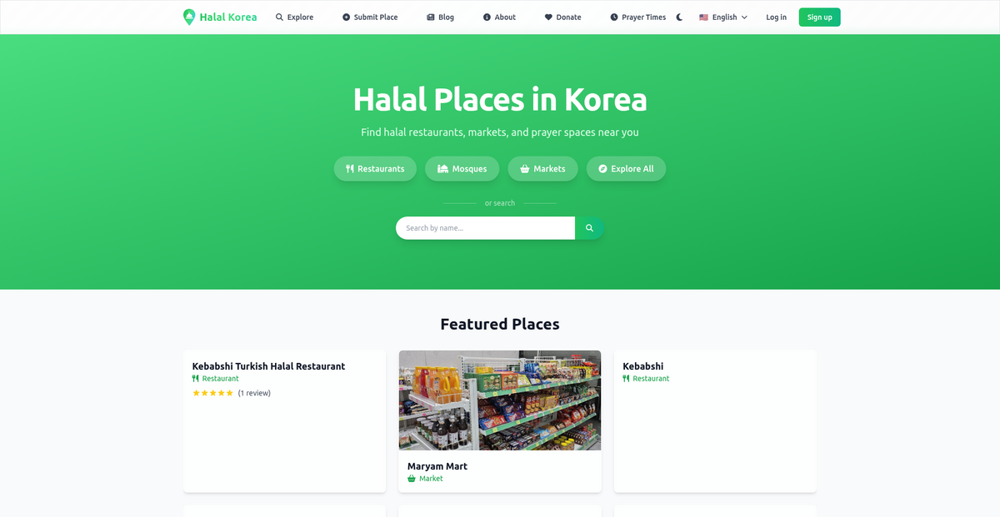
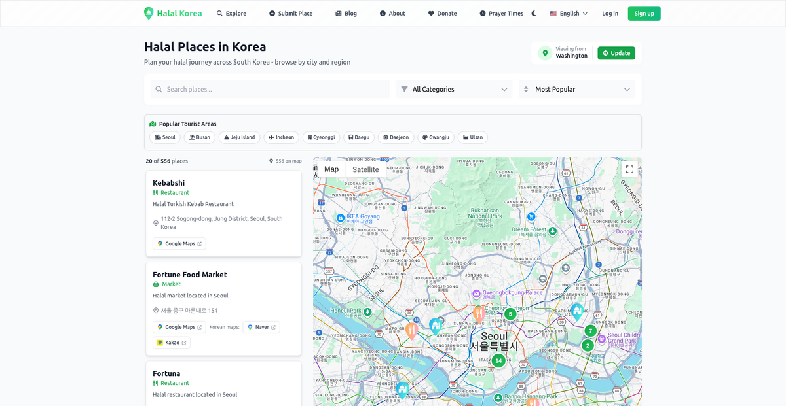
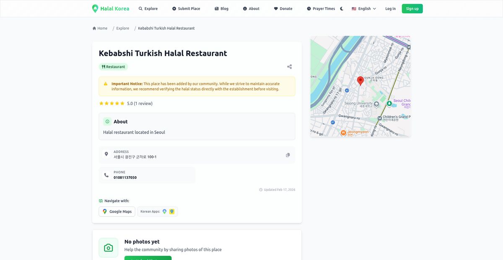
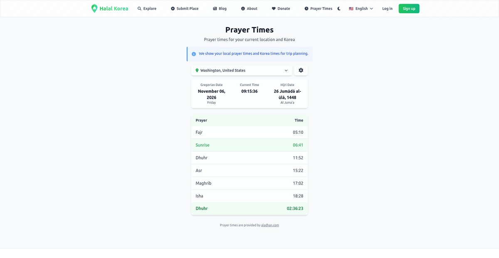
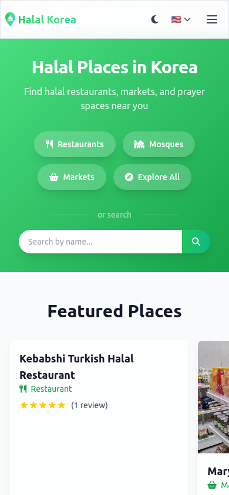
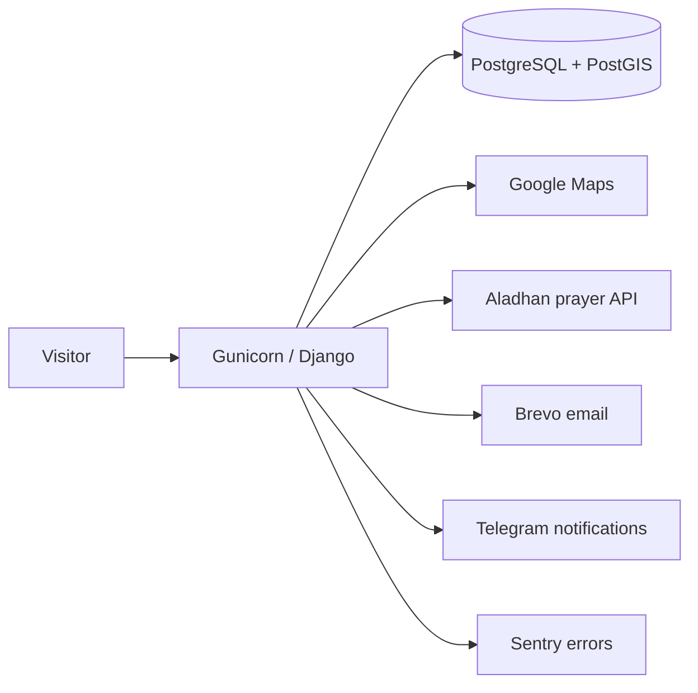

# Halal Korea

Find halal restaurants, markets, mosques and prayer rooms across South Korea.

**Live site: [halal-korea.com](https://halal-korea.com)**



Halal Korea is a community-driven directory web app. Visitors can browse and search
hundreds of halal places on an interactive map, check prayer times for any
location in Korea, and read the blog. Registered users contribute back: they submit
new places, suggest edits, photos and opening hours, and leave reviews. Every
contribution goes through an admin moderation workflow before it goes live.

## Screenshots

| Explore map | Place detail |
| --- | --- |
|  |  |

| Prayer times | Mobile |
| --- | --- |
|  |  |

## Features

- **Place directory** - restaurants, markets, mosques and prayer rooms with categories,
  city browsing and featured places.
- **Interactive map** - category markers, satellite view, and one-tap navigation links
  for Google Maps, Naver and Kakao.
- **Search** - by name, category and city, plus nearby search around your location.
- **Community contributions** - visitors submit places, edits, photos and business
  hours; admins review them in a moderation queue with bulk actions.
- **Reviews and ratings** - per place, with cached rating rollups.
- **Prayer times** - daily times for your location and Korea, Hijri date,
  next-prayer countdown, Ramadan timetable and shareable timetable images
  (Aladhan API).
- **Accounts** - email signup with verification, plus Google and GitHub social login
  (django-allauth).
- **Blog** - categorized posts with search and archives.
- **Contact and feedback** - public forms protected by Cloudflare Turnstile.
- **Multilingual** - English, Korean and Uzbek.
- **Admin toolkit** - Jazzmin admin theme, monitoring dashboard, admin email composer,
  CSV/JSON/GeoJSON import and export, Telegram notifications, optional Sentry.

## Tech stack

| Layer | Technology |
| --- | --- |
| Backend | Django 5.1 (GeoDjango), Python 3.12, Gunicorn |
| Database | PostgreSQL 15 + PostGIS 3.3 |
| Frontend | Django templates, custom CSS and JavaScript |
| Admin UI | django-jazzmin |
| Auth | django-allauth (email, Google, GitHub) |
| External services | Google Maps, Aladhan prayer times API, Brevo email, Telegram Bot API, Cloudflare Turnstile, Sentry (optional) |
| Packaging | Docker + Docker Compose |



## Quick start (Docker)

Prerequisites: Docker with the Compose plugin.

```bash
git clone https://github.com/JavohirMX/halal-korea.git
cd halal-korea
cp .env.example .env
```

Edit `.env` and set at least:

- `DJANGO_SECRET_KEY` - any long random string
- `DB_HOST=db` - the Compose database service name
- `DB_PASSWORD` / `POSTGRES_PASSWORD` - matching passwords
- `GOOGLE_MAPS_API_KEY` - required for maps

Then:

```bash
docker compose up --build -d
docker compose exec web python manage.py migrate
docker compose exec web python manage.py createsuperuser   # optional, for /admin/
```

The site is served at <http://127.0.0.1:8000>.

## Local development

Prerequisites: Python 3.12, PostgreSQL 15 with the PostGIS extension, and the GDAL
system libraries (the `apt-get install` list in the [Dockerfile](Dockerfile) shows
exactly which ones).

```bash
python -m venv .venv && source .venv/bin/activate
pip install -r requirements.txt
cp .env.example .env        # set DJANGO_SECRET_KEY, DB_* and GOOGLE_MAPS_API_KEY
python manage.py migrate
python manage.py runserver
```

## Tests

```bash
python manage.py test                  # or: docker compose exec web python manage.py test
```

See [docs/TESTING.md](docs/TESTING.md) for the suite layout and conventions.

## Configuration

All configuration lives in environment variables; [.env.example](.env.example) is the
documented template. Required to boot: `DJANGO_SECRET_KEY`, `ALLOWED_HOSTS`,
`DB_NAME`/`DB_USER`/`DB_PASSWORD`/`DB_HOST`, and `GOOGLE_MAPS_API_KEY`.
Everything else is optional and feature-gated: Sentry (only active outside DEBUG),
Turnstile keys, email backend (console backend by default in development), Telegram
notifications, and social-login credentials.

## Project layout

```
places/        directory, search, map, suggestions and import/export
prayer_times/  prayer times, Ramadan timetable, share images
reviews/       place reviews and ratings
users/         accounts, profiles, admin email tools
blog/          blog posts and categories
contact/       contact form
feedback/      feedback API
utils/         monitoring, logging, location and cache helpers
config/        Django settings, URLs, middleware, sitemaps
docs/          feature and operations documentation
```

## Documentation

Detailed guides live in [docs/](docs/), including
[testing](docs/TESTING.md),
[logging](docs/LOGGING_SYSTEM.md),
[monitoring](docs/MONITORING_SYSTEM.md),
[backups](docs/BACKUP_SYSTEM.md),
[data import/export](docs/IMPORT_EXPORT_GUIDE.md),
[translations](docs/TRANSLATION_GUIDELINES.md),
[Turnstile setup](docs/TURNSTILE.md) and
[social login setup](docs/EXTERNAL_LOGIN_SETUP.md).
[PROJECT_CONTEXT.md](PROJECT_CONTEXT.md) gives a codebase-oriented overview.

## Contributing

Contributions are welcome, in code or in content:

- **Add or fix a place** - use [Submit Place](https://halal-korea.com/submit/) or the
  suggestion buttons on any place page; no account setup needed for a pull request.
- **Code** - fork the repo, create a branch, run `python manage.py test`, and open a
  pull request against `main`. Follow the existing style; see
  [docs/TRANSLATION_GUIDELINES.md](docs/TRANSLATION_GUIDELINES.md) when touching
  user-facing text.
